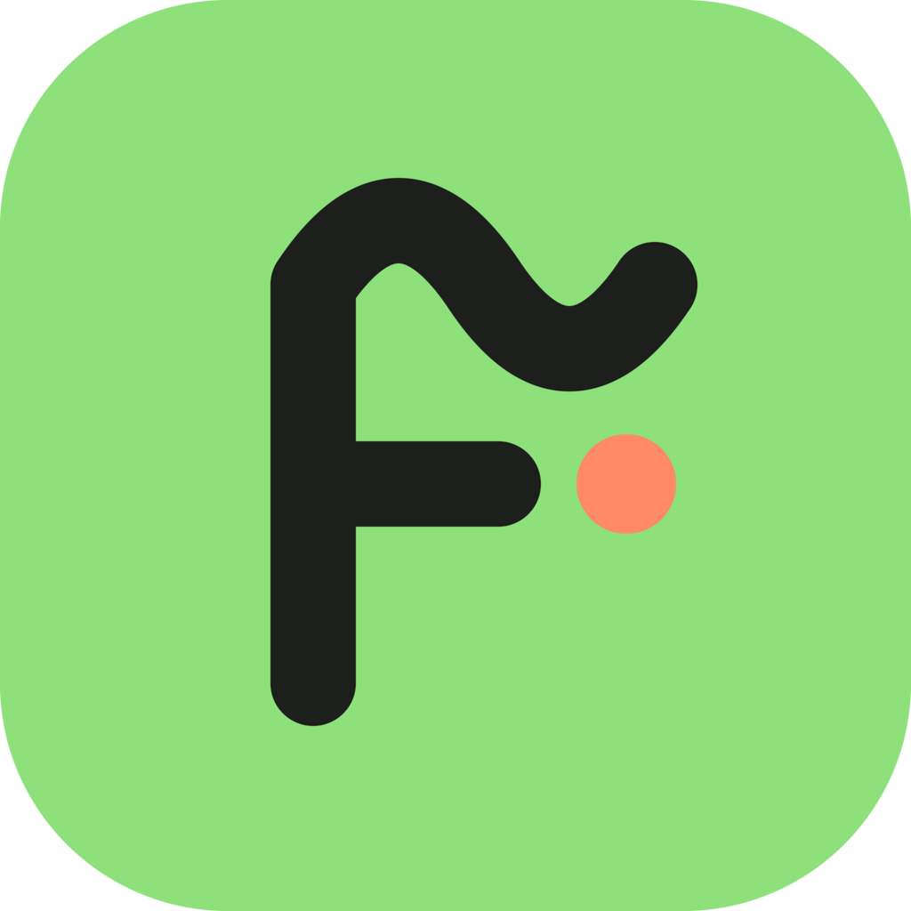

# Fakturáček

**Jednoduchý program na faktury pro malé podnikatele.**
Vystavíš fakturu, zapíšeš výdaje a na konci roku vidíš, kolik jsi vydělal. Nic víc.

Fakturáček je pro české živnostníky (OSVČ), kteří **nejsou plátci DPH**.
Je zdarma, česky a funguje bez internetu.

## Proč Fakturáček

- **Jednoduchý.** Žádné účetnictví, žádné desítky nastavení. Jen to, co malý podnikatel opravdu používá.
- **Rychlý.** Spustí se hned a nic nezdržuje.
- **Tvoje data zůstávají u tebe.** Žádný účet, žádné předplatné, žádný server. Faktury a výdaje
  se ukládají do složky v tvém počítači. Fakturáček neposílá žádná data o tom, jak ho používáš.
- **Na dvou počítačích.** Datovou složku můžeš mít v OneDrive, Google Disku, Dropboxu nebo Nextcloudu.
  Fakturáček pohlídá, aby nebyla otevřená na dvou místech současně.
- **Automatické zálohy** každý den a export všech dat do jednoho souboru.
- **Sám se aktualizuje.** Novou verzi stáhne na pozadí a nainstaluje, až mu to dovolíš.

## Co umí

| | |
|---|---|
| **Faktury** | Faktura v Kč nebo v eurech, PDF s QR platbou, odeslání e-mailem, označení zaplaceno. |
| **Číslování** | Hotové předvolby (např. `2026-007`) nebo vlastní vzor. Navážeš na číslování z jiného programu. |
| **Klienti a ceník** | Údaje klienta načteš z ARES podle IČO, opakované položky vložíš z ceníku. |
| **Výdaje** | Datum, dodavatel, částka, kategorie a příloha (účtenka v PDF nebo fotka). |
| **Roční přehled** | Příjmy podle data úhrady, výdaje a rozdíl po měsících. Export do CSV a PDF jako podklad pro daňové přiznání. |
| **Vzhled** | Světlý i tmavý motiv. Na faktuře tvoje logo, podpis a jedna z pěti barev. |

> **Stav vývoje:** Fakturáček se teprve rodí. Verze 0.1 obsahuje základ: nastavení údajů, účtů,
> číslování, vzhledu faktury, datovou složku, zálohy a aktualizace. Vystavování faktur, výdaje
> a roční přehled přibudou v dalších verzích. Díky automatickým aktualizacím je dostaneš samy.

## Stažení a instalace

Aktuální verzi najdeš v sekci [Releases](../../releases/latest).

- **Windows 10 a 11:** stáhni soubor `…_x64-setup.exe` a spusť ho.
  Instalátor zatím není digitálně podepsaný, proto Windows může ukázat modré okno
  „Systém Windows ochránil váš počítač“. Klikni na **Další informace** a pak **Přesto spustit**.
- **Linux:**
  - `.AppImage` funguje skoro všude: nastav souboru právo ke spuštění a spusť ho.
    Aktualizuje se sám.
  - `.deb` (Ubuntu, Debian, Mint) nebo `.rpm` (Fedora, openSUSE): nainstaluj správcem balíčků.
    Při aktualizaci se Fakturáček zeptá na heslo správce.

macOS ani mobilní verze nejsou plánované.

## Časté otázky

**Kolik to stojí?**
Nic. Fakturáček je zdarma i pro komerční použití.

**Jsem plátce DPH. Můžu ho používat?**
Ne. Fakturáček je jen pro neplátce DPH a vystavuje faktury s textem „Nejsem plátce DPH“.

**Kde jsou moje data?**
Ve složce, kterou zvolíš při prvním spuštění (výchozí je `Dokumenty/Fakturáček`).
Je tam databáze, PDF faktur, přílohy výdajů a zálohy.

**Kdy se Fakturáček připojuje k internetu?**
Jen když načítáš údaje z registru ARES, stahuješ kurz eura z ČNB a když hledá aktualizace.
Jinak funguje úplně bez připojení.

**Počítá mi daně?**
Ne. Roční přehled je podklad pro daňové přiznání, nejde o daňové poradenství.

## Změny

Seznam změn je u každé verze v sekci [Releases](../../releases).

## Licence

Fakturáček je freeware s uzavřeným zdrojovým kódem. Můžeš ho zdarma používat a šířit v nezměněné podobě.
Seznam použitých knihoven a písem a jejich licencí bude součástí aplikace (okno O aplikaci).

© 2026 Jan Těžký
